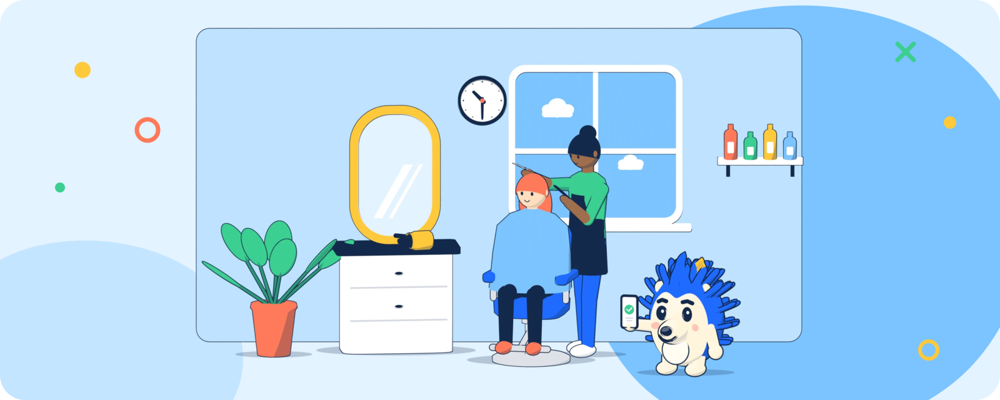
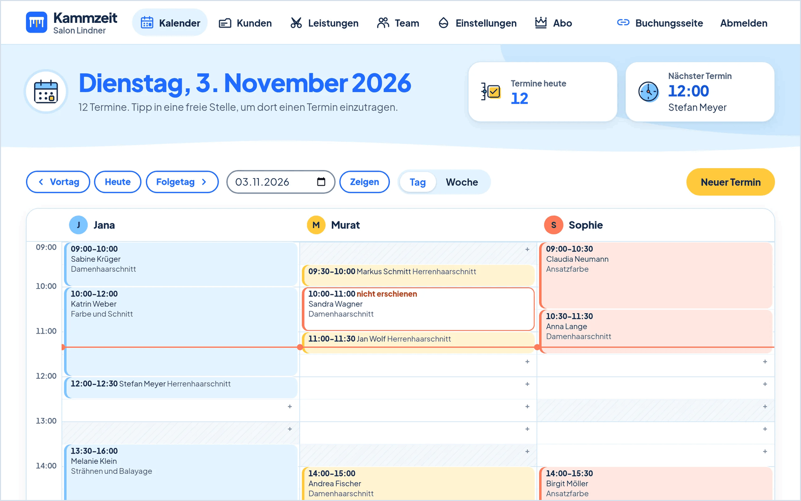
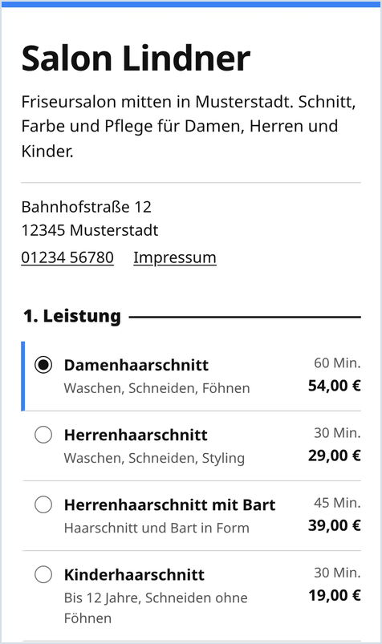
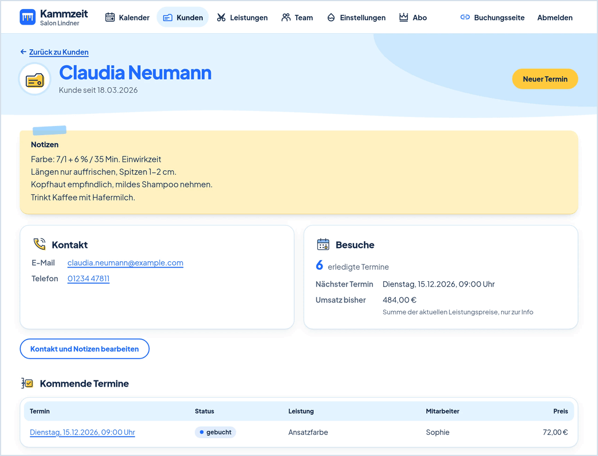

<div align="center">


**Online-Terminbuchung für Friseure, Barbershops und Beauty-Salons.**

[](LICENSE)
[](go.mod)

[kammzeit.de](https://kammzeit.de) · [kammzeit.com](https://kammzeit.com) · [Demo](https://demo.kammzeit.de) · [Selbst hosten](docs/selbsthosten.md) · [In English](#in-english)



</div>

## Worum es geht


Jeder Salon bekommt eine eigene Buchungsseite. Kunden wählen dort Leistung, Mitarbeiter und Uhrzeit und buchen rund um die Uhr selbst, ohne Konto und ohne App. Bestätigung und Erinnerung kommen per Mail.

Der Salon sieht alle Termine im Kalender, führt seine Kundenkartei und pflegt Leistungen, Team und Arbeitszeiten im Dashboard. Angemeldet wird per Einmal-Link, ein Passwort gibt es nicht.

Gehostet auf [kammzeit.de](https://kammzeit.de) (Deutsch) und [kammzeit.com](https://kammzeit.com) (Englisch) oder selbst betrieben: eine einzige Go-Binary, SQLite als Datenbank, keine weiteren Dienste außer einem Mailserver.

## So sieht es aus

<table>
  <tr>
    <td colspan="2" align="center"><br><sub><b>Kalender</b> · Tag oder Woche, eine Farbe je Mitarbeiter</sub></td>
  </tr>
  <tr>
    <td align="center" valign="top"><br><sub><b>Buchungsseite</b> am Handy</sub></td>
    <td align="center" valign="top"><br><sub><b>Kundenkarte</b> · Notizen und alle Termine</sub></td>
  </tr>
</table>

Buchungsseite zum Ausprobieren: [demo.kammzeit.de](https://demo.kammzeit.de).

## Funktionen

<table>
  <tr>
    <td width="33%" valign="top"><br><b>Eigene Buchungsseite</b><br>Unter <code>&lt;salon&gt;.kammzeit.de</code> oder der eigenen Domain, in der Akzentfarbe des Salons. Kunden buchen ohne Konto.</td>
    <td width="33%" valign="top"><br><b>Bestätigung und Erinnerung</b><br>Mail mit Kalendereintrag und Link zum Absagen, Erinnerung 24 Stunden vor dem Termin.</td>
    <td width="33%" valign="top"><br><b>Kalender</b><br>Tages- und Wochenansicht. Termine eintragen, verschieben, absagen oder als nicht erschienen markieren.</td>
  </tr>
  <tr>
    <td valign="top"><br><b>Kundenkartei</b><br>Kontakt, Notizen wie die Farbrezeptur und alle kommenden und vergangenen Termine auf einer Karte.</td>
    <td valign="top"><br><b>Leistungen</b><br>Mit Dauer und Preis. Je Leistung festlegen, wer sie anbietet.</td>
    <td valign="top"><br><b>Team</b><br>Arbeitszeiten je Mitarbeiter und Wochentag, auch mit Mittagspause.</td>
  </tr>
  <tr>
    <td valign="top"><br><b>Buchungsregeln</b><br>Mindestvorlauf, Absagefrist und wie weit im Voraus gebucht werden kann.</td>
    <td valign="top"><br><b>Login ohne Passwort</b><br>Einmal-Link per Mail. Kein Passwort, das verloren gehen kann.</td>
    <td valign="top"><br><b>Eigene Daten</b><br>Export aller Salondaten als JSON, Konto jederzeit selbst löschen.</td>
  </tr>
  <tr>
    <td valign="top"><br><b>Deutsch und Englisch</b><br>kammzeit.de auf Deutsch, kammzeit.com auf Englisch, Buchungsseite in der Sprache des Salons. Gehostet in Eygelshoven (NL).</td>
    <td valign="top"><br><b>Open Source</b><br>AGPL-3.0. Selbst gehostet im Einzelbetrieb ohne Grenze bei den Mitarbeitern und ohne Kammzeit-Hinweis.</td>
    <td valign="top"><br><b>Gratis starten</b><br>Gehostet gratis mit einem Mitarbeiter. Pro mit beliebig vielen: 14,90 € im Monat oder 149 € im Jahr.</td>
  </tr>
</table>

## Schnellstart

Voraussetzung: Go in der Version aus [go.mod](go.mod) oder neuer.

```sh
go run . demo
SITE_URL=http://localhost:8080 PUBLIC_URL='http://{slug}.localhost:8080' go run .
```

`demo` legt den Beispiel-Salon "demo" mit Leistungen, zwei Mitarbeitern und dem Konto `demo@example.com` an. Die Datenbank landet in `kammzeit.db` im aktuellen Verzeichnis.

| Was | Adresse |
|---|---|
| Startseite | <http://localhost:8080> |
| Buchungsseite des Demo-Salons | <http://demo.localhost:8080> |
| Dashboard | <http://localhost:8080/login> mit `demo@example.com` |

Ohne `SMTP_HOST` werden Mails nur ins Log geschrieben, dort steht auch der Login-Link. `SITE_URL` und `PUBLIC_URL` sorgen nur dafür, dass Links in Mails lokal stimmen. Ohne sie läuft der Server genauso, die Links zeigen dann auf `https://localhost`.

## Konfiguration

Alles über Umgebungsvariablen. Für einen einzelnen Salon reichen `KAMMZEIT_SINGLE_TENANT=1`, `PUBLIC_URL` und die SMTP-Werte.

### Server und Domains

| Variable | Standard | Bedeutung |
|---|---|---|
| `PORT` | `8080` | Port, wenn `LISTEN` nicht gesetzt ist |
| `LISTEN` | `:<PORT>` | Adresse, auf der der Server lauscht. Hinter einem Reverse-Proxy: `127.0.0.1:8080` |
| `BASE_DOMAIN` | `localhost` | Hauptdomain. Salons laufen unter `<slug>.<BASE_DOMAIN>` |
| `BASE_DOMAINS` | leer | Mehrere Hauptdomains mit Sprache (`de` oder `en`), z. B. `kammzeit.de=de,kammzeit.com=en`. Die erste ist die Standarddomain und nutzt `SITE_URL` und `PUBLIC_URL`, jede weitere läuft unter `https://<domain>` und `https://<slug>.<domain>`. Leer: nur `BASE_DOMAIN` auf Deutsch |
| `SITE_URL` | `https://<BASE_DOMAIN>`, im Einzelbetrieb wie `PUBLIC_URL` | Adresse von Startseite, Login und Dashboard, Basis für Login-Links |
| `PUBLIC_URL` | `https://{slug}.<BASE_DOMAIN>`, im Einzelbetrieb `http://localhost:<PORT>` | Adresse der Buchungsseiten, Basis für Links in Buchungsmails. `{slug}` wird durch den Salon ersetzt |
| `DB_PATH` | `kammzeit.db` | SQLite-Datei |
| `KAMMZEIT_SINGLE_TENANT` | leer | `1` = Einzelbetrieb: genau ein Salon, alles unter einer Domain, keine Subdomains |

### Mail

| Variable | Standard | Bedeutung |
|---|---|---|
| `SMTP_HOST` | leer | Mailserver. Leer: Mails werden nur ins Log geschrieben |
| `SMTP_PORT` | `587` | Port des Mailservers (STARTTLS, Port 465 wird nicht unterstützt) |
| `SMTP_USER` | leer | Benutzername am Mailserver, leer = ohne Anmeldung |
| `SMTP_PASS` | leer | Passwort am Mailserver |
| `SMTP_FROM` | `Kammzeit <noreply@localhost>` | Absender aller Mails |
| `MARKETING_SECRET` | leer | Geheimer Schlüssel (mindestens 16 Zeichen) für die Abmeldelinks der Kammzeit-News: der Link in jeder Marketing-Mail meldet ohne Anmeldung ab (HMAC über die Konto-ID). Leer: der Link führt in die Einstellungen, Abmelden nur angemeldet. Die Bestätigungslinks (Double-Opt-in) brauchen ihn nicht. Langen Zufallswert setzen, z. B. aus `openssl rand -hex 32`, und nicht mehr ändern (alte Abmeldelinks werden sonst ungültig) |

### Abo über Stripe (nur gehostete Version)

| Variable | Standard | Bedeutung |
|---|---|---|
| `STRIPE_SECRET_KEY` | leer | Geheimer API-Schlüssel von Stripe (`sk_...`) |
| `STRIPE_WEBHOOK_SECRET` | leer | Signing-Secret des Webhooks `/stripe/webhook` (`whsec_...`) |
| `STRIPE_PRICE_MONTHLY` | leer | Stripe-Preis-ID (`price_...`) für Pro monatlich |
| `STRIPE_PRICE_YEARLY` | leer | Stripe-Preis-ID (`price_...`) für Pro jährlich |

## Befehle

Die Binary liest dieselben Umgebungsvariablen, vor allem `DB_PATH`.

| Befehl | Wirkung |
|---|---|
| `kammzeit` | Startet den Server |
| `kammzeit demo` | Legt den Beispiel-Salon "demo" an (Login `demo@example.com`, Plan Pro). Mehrfach aufrufbar, legt nichts doppelt an |
| `kammzeit session <email>` | Legt eine Session für das Konto an und gibt `kz_session=...` aus. Zum Testen mit curl oder als Notzugang, wenn keine Mails ankommen |

## Selbst hosten

Anleitung mit systemd, Caddy, SMTP, Backups und Updates: **[docs/selbsthosten.md](docs/selbsthosten.md)**.

Kurz mit Docker:

```sh
docker build -t kammzeit .
docker run -d --name kammzeit -p 127.0.0.1:8080:8080 -v kammzeit-data:/data \
  -e PUBLIC_URL=https://termine.example.de kammzeit
```

Das Image startet im Einzelbetrieb, die Datenbank liegt im Volume unter `/data/kammzeit.db`.

## Technik

- **Go** mit der Standardbibliothek: `net/http` (Routing mit Go-1.22-Mustern), `html/template`, `embed`. Templates und statische Dateien unter `web/` stecken in der Binary.
- **SQLite** über [modernc.org/sqlite](https://modernc.org/sqlite), reines Go, kein CGO. Schema in [schema.sql](schema.sql).
- **htmx 2** für die wenigen dynamischen Stellen, kein JS-Framework. Schriften und Skripte kommen vom eigenen Server, keine Tracker.
- Ein einziges Go-Paket, eine direkte Abhängigkeit in [go.mod](go.mod).

## Entwicklung

```sh
go test ./...
go vet ./...
gofmt -l .   # muss leer bleiben
```

Änderungen an bestehenden Tabellen nur als neuer Eintrag in `migrations` in [model.go](model.go).

Rauchtest gegen einen laufenden Server, Salon über den Host-Header:

```sh
BASE_DOMAIN=kammzeit.test go run .
curl -H 'Host: demo.kammzeit.test' http://localhost:8080/
curl -H 'Host: kammzeit.test' -H "Cookie: $(go run . session demo@example.com)" http://localhost:8080/dashboard
```

## Lizenz

[GNU AGPL-3.0](LICENSE) oder später. Wer Kammzeit verändert und als Netzdienst betreibt, muss den Nutzern den geänderten Quellcode zugänglich machen (§ 13 AGPL). Das gilt auch für eine selbst gehostete Installation mit eigenen Änderungen.

---

## In English

Kammzeit is open-source online booking for hairdressers, barbershops and beauty salons. Every salon gets its own booking page where customers choose a service, a staff member and a time, without creating an account. Confirmation and reminder arrive by email. The salon manages appointments, customer records, services and working hours in the dashboard and logs in with a one-time link, no password.

Use the hosted version at [kammzeit.com](https://kammzeit.com) (English) or [kammzeit.de](https://kammzeit.de) (German), try the [demo](https://demo.kammzeit.de), or run it yourself: a single Go binary with SQLite, nothing else but a mail server.

**Quick start** (Go version from [go.mod](go.mod) or newer):

```sh
go run . demo
SITE_URL=http://localhost:8080 PUBLIC_URL='http://{slug}.localhost:8080' go run .
```

Booking page of the demo salon: <http://demo.localhost:8080>. Dashboard: <http://localhost:8080/login> with `demo@example.com`. Without `SMTP_HOST`, emails (including the login link) are only written to the log.

Configuration works through environment variables, see the tables under [Konfiguration](#konfiguration). The self-hosting guide [docs/selbsthosten.md](docs/selbsthosten.md) is in German.

Licence: [GNU AGPL-3.0](LICENSE) or later. If you modify Kammzeit and run it as a network service, you must offer your users the modified source code.
